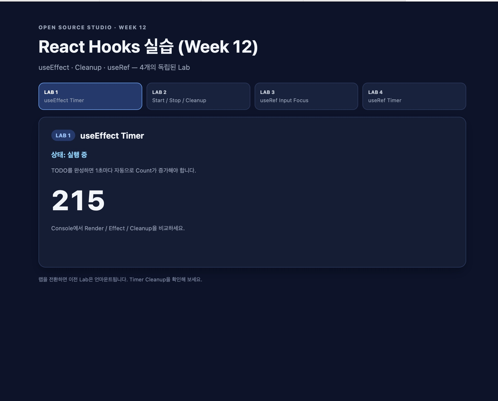

# OSS Week 12

## Project Information
- 프로젝트 소개: React Hooks을 써서 타이머 제어와 DOM 포커스 기능을 실습한 앱입니다.
- Starter Project 정보: week12_starter_project를 가져와서 LAB 1~4를 완성하고 화면 스타일과 제목을 수정했습니다. 그리고 실행 여부 표시를 원래 있던 건 이름을 수정하고 추가했습니다.

## 실행 방법
Node.js 20.19+ 또는 22.12+ 권장. 프로젝트 폴더에서 실행:

```bash
npm install
npm run dev

```


## Source Code Exploration
주요 파일 구조: Lab1EffectTimer, Lab2TimerControl, Lab3InputFocus, Lab4RefTimer 컴포넌트와 스타일 파일로 구성되어 있습니다.
- useEffect 분석: setInterval 생성과 clearInterval를 담당하고 의존성 배열에 따라 실행 시점이 달라집니다.
- useRef 분석: 리렌더링을 하지않아도 값을 유지하거나 DOM에 접근할 때 사용했습니다.
주요 코드 2개 설명:
- setCount((prev) => prev + 1): 이전 상태에서 값을 올리는 코드입니다.
- timerRef.current = setInterval(...): 다시 화면을 바꿔도 타이머 ID가 초기화되지 않게 보관하고 중복 실행을 막을 때 쓰는 코드입니다.

## Lab Implementation
- LAB 1 (useEffect Timer): 1초마다 카운트가 증가하고 cleanup에서 clearInterval로 타이머를 정리합니다.
- LAB 2 (Timer Start / Stop / Reset): running 상태와 [running]을 활용해 타이머 시작, 정지, 초기화를 구현했습니다.
- LAB 3 (Input Focus with useRef): inputRef로 입력창에 포커스를 주고, 초기화 후에도 포커스가 유지되도록 했습니다.
- LAB 4 (Timer with useRef): useRef로 타이머 ID를 관리하고 useState로 화면에 실행 상태를 표시했습니다.

## Lab Comparison
1. `setCount(prev => prev + 1)`은 왜 유용한가?
  - 이걸 사용하지 않으면 숫자가 그대로 똑같은 숫자만 계속 반복이 돼서 이 코드를 써야 이전 값에서 하나씩 올라간다.
2. `useEffect(fn, [])`과 `useEffect(fn)`은 어떻게 다른가?
  - []를 넣으면 처음 마운트될 때 한 번만 실행되고 의존성 부분을 생략하면 렌더링될 때마다 실행된다.
3. Cleanup은 언제 실행되는가? 개발 환경 StrictMode 영향은?
  - Cleanup은 이전 Effect가 했던 작업을 정리할 때 실행되고 StrictMode에서는 Effect의 설정과 정리 과정이 추가로 한 번 더 실행될 수 있다.
4. `useState`와 `useRef`의 값 변경 시 렌더링 차이는?
  - useState는 상태 값이 바뀌면 컴포넌트가 다시 렌더링되어 화면에 바뀐 값이 반영되는데 useRef는 다시 렌더링되어도 값을 그대로 유지한다.
5. LAB 2와 LAB 4에서 Timer를 관리하는 방식의 차이는?
  - LAB 2는 useState 상태 변화에 맞춰서 useEffect가 타이머를 만들고 정리하고 LAB 4는 useRef에 타이머 ID를 두고 버튼 함수에서 직접 관리한다.

## Customizing
- 수정 내용: 네이비 색의 테마로 배경과 네이비 색에 어울릴만한 박스 색을 바꿨고, 프로젝트 제목을 수정하고 타이머 실행 상태 표시를 원래 있던건 이름을 바꾸고 Lab1처럼 없던건 추가해봤습니다.

## Deployment
Vercel 배포 URL: https://assign12-c01-22201044.vercel.app

## Weekly Review
새롭게 배운 내용 3가지:
- useEffect의 cleanup이 언제 실행되는지와 의존성 배열의 역할
- useRef는 값이 바뀌어도 리렌더링되지 않으며 타이머 ID나 DOM에 유용하다는 점
- useState와 useRef을 구분해서 쓰는 법
어려웠던 점과 해결:
- 처음에 코드를 이해할 때 막히는 부분들은 AI를 통해서 이해를 해봤고 강의안을 보고도 코드를 추가하는데 문제가 없어서 괜찮았습니다.
AI 활용 내용 및 느낀 점:
- 코드를 이해할 때나 강의안에서 왜 이 코드를 쓰는지에 대해서 물어보기만 하고 강의안을 보고 이해하고 코드를 추가를 했습니다. 그외에는 사용하지 않고 네이비에 어울릴만한 박스 색을 바꿀 때 색 코드를 물어봤습니다. 그리고 Cleanup 관해서 막힐 때 물어보고 이해해서 해결했습니다.